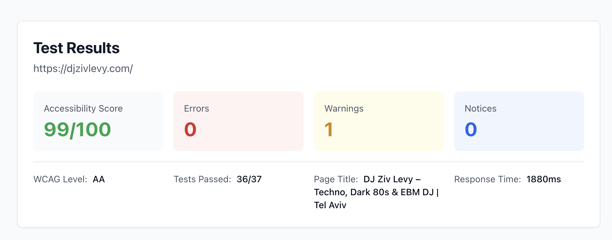

# ACCESSIBILITY TEST RESULTS

Last updated: November 24, 2026

This page shows the results of automated accessibility testing of [djzivlevy.com](https://djzivlevy.com) (the "**Site**"). For our conformance status, known limitations and contact details, see the [Accessibility Statement](https://djzivlevy.com/accessibility).

## ACHECKER.CA

We tested the Site with [achecker.ca](https://achecker.ca/), a web accessibility checker, against **WCAG 2.2 level AA**. We ran the checks for both **mobile** and **desktop** web.

These are the results in the report shown below:

- **Page tested:** [https://djzivlevy.com/](https://djzivlevy.com/) (home page)
- **WCAG level:** AA
- **Accessibility score:** 99/100
- **Tests passed:** 36 of 37
- **Errors:** 0
- **Warnings:** 1
- **Notices:** 0

## WHAT THESE RESULTS MEAN

Automated tools find many accessibility problems, but not all of them, and a score is not a guarantee of full conformance. We also test by hand, as described in [How we test](https://djzivlevy.com/accessibility#4-how-we-test).

If something on the Site does not work for you, please tell us: [levi.ziv@gmail.com](mailto:levi.ziv@gmail.com).
